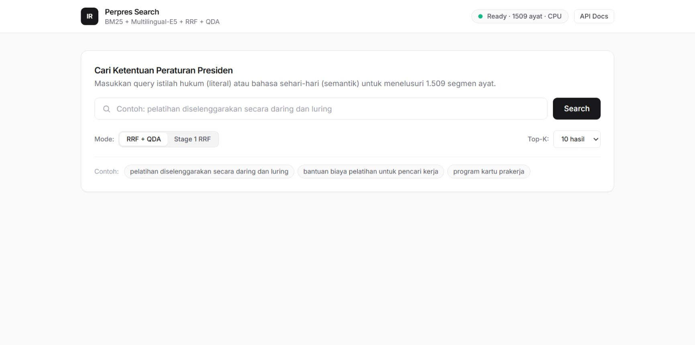
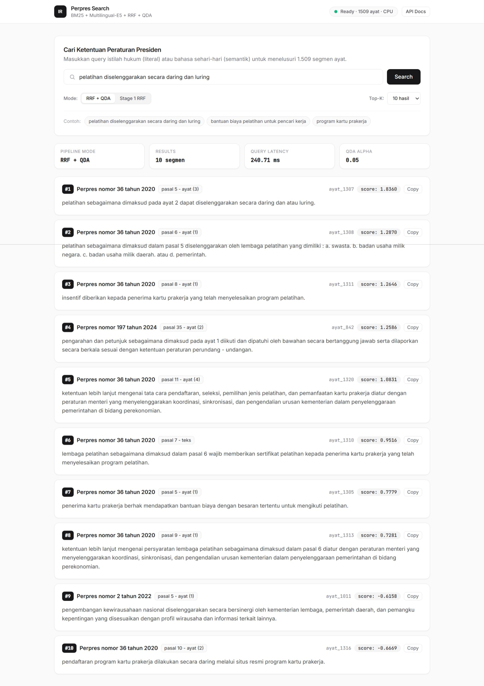
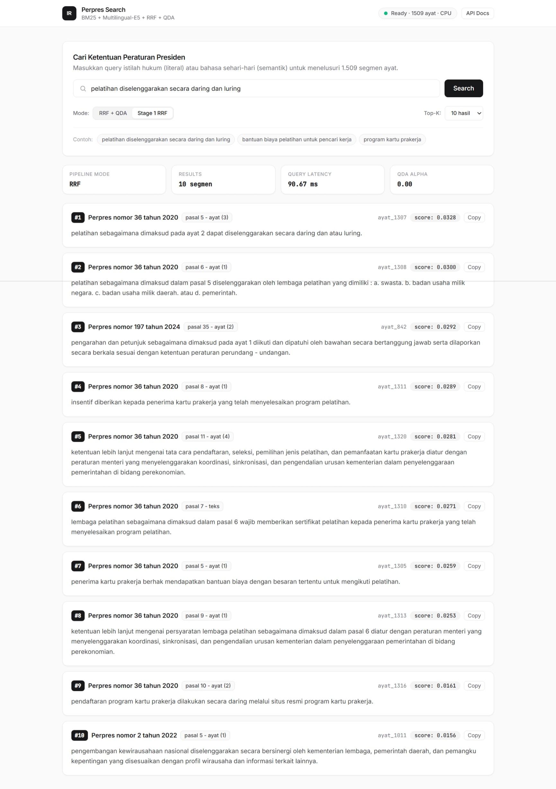

# Perpres Hybrid Retrieval & QDA Web Demo

Aplikasi web dan RESTful API untuk mencari segmen ayat Peraturan Presiden (Perpres) berbahasa Indonesia menggunakan pipeline dua tahap **BM25 + Multilingual-E5 + Reciprocal Rank Fusion (RRF) + Query-Document Attention (QDA)**.

---

## Ringkasan Arsitektur

Sistem memproses pencarian terhadap **1.509 segmen ayat** dari 115 Peraturan Presiden melalui dua tahap:

1. **Stage 1 — Hybrid Retrieval (`RRF`):**
   * **Sparse Retrieval:** `BM25Okapi` untuk menangkap kecocokan kata kunci hukum secara persis (*query literal*).
   * **Dense Retrieval:** `intfloat/multilingual-e5-small` (384 dimensi, parameter beku, *mean pooling* dengan prefix `"query: "` dan `"passage: "`) untuk menangkap kemiripan makna (*query semantik*).
   * **Fusion:** Menggabungkan Top-25 sparse dan Top-25 dense menggunakan *Reciprocal Rank Fusion* ($k = 60$) menjadi maksimal 20 kandidat unik.

2. **Stage 2 — Reranking (`RRF + QDA`):**
   * Modul **Query-Document Attention (QDA)** (Multi-Head Cross-Attention 4 kepala, FFN 384-1536-384, ~1,77 juta parameter) menghitung skor relevansi antar-token query dan dokumen kandidat.
   * Skor akhir dihitung melalui fusi konveks ternormalisasi: $\alpha \cdot z(\text{QDA}) + (1 - \alpha) \cdot z(\text{RRF})$ dengan bobot optimal $\alpha = 0,05$.

---

## Fitur Utama

* **Dashboard Pencarian Web (`/`):** Antarmuka berbasis Tailwind CSS dengan gaya komponen shadcn/ui, dilengkapi indikator status engine (`/health`), pemilih mode (**`RRF + QDA`** vs **`Stage 1 RRF`**), pengaturan `Top-K` (`5`, `10`, `20`), contoh query cepat, kartu metrik latensi, serta tombol salin teks ayat.
* **RESTful API (`/search`, `/health`, `/docs`):** Endpoint FastAPI dengan dokumentasi Swagger UI interaktif di `/docs`.
* **Mendukung Mode Offline:** Dengan menjalankan `setup_local.py` satu kali, encoder dasar dan artefak korpus disimpan secara lokal sehingga server dapat berjalan tanpa koneksi internet.

---

## Tangkapan Layar (Screenshots)

### 1. Halaman Utama Dashboard
Menampilkan status kesiapan engine (`Ready · 1509 ayat · CPU`), tautan `API Docs`, kotak pencarian, pemilih mode peringkat, pengaturan `Top-K`, serta contoh query.



### 2. Hasil Pencarian Mode `RRF + QDA`
Hasil untuk query `"pelatihan diselenggarakan secara daring dan luring"` menggunakan fusi `RRF + QDA` ($\alpha = 0.05$), menampilkan ringkasan metrik (10 segmen, latensi 240,71 ms) dan peringkat teratas `#1 ayat_1307` (`Perpres nomor 36 tahun 2020`, `pasal 5 - ayat (3)`).



### 3. Hasil Pencarian Mode `Stage 1 RRF`
Hasil untuk query yang sama dengan mode baseline `Stage 1 RRF` ($\alpha = 0.00$, latensi 90,67 ms) sebagai pembanding langsung skor dan urutan kandidat sebelum reranking QDA.



---

## Struktur File

```text
Web IR/
├── main.py                              # Server FastAPI (/, /health, /search, /docs)
├── engine.py                            # Engine Stage 1 (BM25 + E5 + RRF) & Stage 2 (QDA)
├── static/
│   └── index.html                       # Dashboard frontend
├── data/
│   └── dataset_korpus_per_ayat.csv      # 1.509 segmen ayat Peraturan Presiden
├── artifacts/
│   └── doc_artifacts.pt                 # Cache token & dense embedding korpus (dibuat lokal)
├── screenshots/
│   ├── 1.jpeg
│   ├── 2.jpeg
│   └── 3.jpeg
├── qda_best.pt                          # Bobot checkpoint QDA terlatih (6,78 MB)
├── config.json                          # Konfigurasi hyperparameter & alpha model
├── setup_local.py                       # Script opsional unduh encoder & bangun cache offline
├── requirements.txt                     # Daftar dependensi Python
└── .gitignore                           # Mengecualikan .venv/, models/, dan artifacts/doc_artifacts.pt
```

---

## Instalasi & Menjalankan Aplikasi

1. **Buat dan aktifkan virtual environment:**
   ```bash
   python -m venv .venv
   # Windows:
   .venv\Scripts\activate
   # Linux/macOS:
   # source .venv/bin/activate
   ```

2. **Pasang dependensi:**
   ```bash
   pip install -r requirements.txt
   ```

3. **Siapkan model & cache lokal (opsional, direkomendasikan agar startup cepat & offline):**
   ```bash
   python setup_local.py
   ```
   *(Jika dilewati, `doc_artifacts.pt` akan otomatis dibuat saat pertama kali server dijalankan.)*

4. **Jalankan server FastAPI:**
   ```bash
   uvicorn main:app --host 0.0.0.0 --port 8000
   ```

5. **Akses aplikasi:**
   * Dashboard Web: `http://localhost:8000`
   * Swagger API Docs: `http://localhost:8000/docs`

---

## Dokumentasi Endpoint API

### `GET /health`
Memeriksa status kesiapan engine, perangkat (`cpu`/`cuda`), jumlah dokumen, dan bobot `rerank_alpha`.

### `GET /search`
* **Query parameters:** `q` (wajib), `top_k` (`1`–`20`, default `10`), `mode` (`hybrid_qda` atau `rrf`, default `hybrid_qda`).
* **Contoh:** `GET /search?q=pelatihan%20daring%20dan%20luring&top_k=5&mode=hybrid_qda`

### `POST /search`
* **Request Body:**
  ```json
  {
    "query": "pelatihan diselenggarakan secara daring dan luring",
    "top_k": 10,
    "mode": "hybrid_qda"
  }
  ```
* **Response Body:**
  ```json
  {
    "query": "pelatihan diselenggarakan secara daring dan luring",
    "mode": "hybrid_qda",
    "qda_loaded": true,
    "rerank_alpha": 0.05,
    "latency_ms": 240.71,
    "results": [
      {
        "rank": 1,
        "doc_id": "ayat_1307",
        "nomor_peraturan": "nomor 36 tahun 2020",
        "sub_segmen": "pasal 5 - ayat (3)",
        "text": "pelatihan sebagaimana dimaksud pada ayat 2 dapat diselenggarakan secara daring dan atau luring.",
        "score": 1.836
      }
    ]
  }
  ```